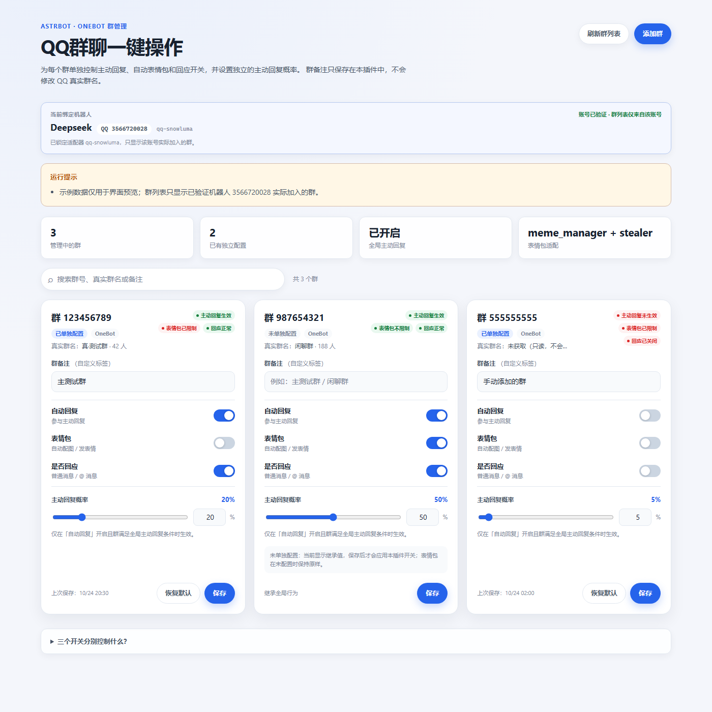
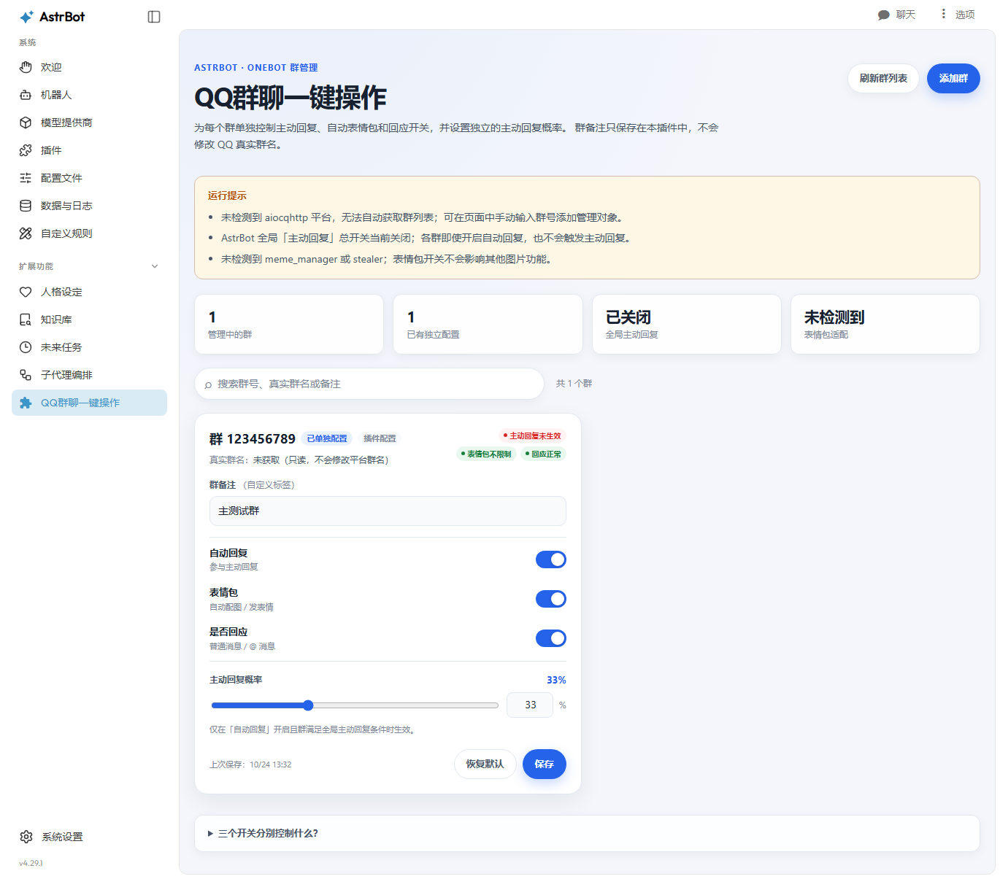

# QQ群聊一键操作

一个面向 AstrBot 的群聊管理插件：在 AstrBot WebUI 中打开独立管理页面，为每个 QQ 群单独控制**主动回复**、**自动表情包**、**是否回应**，并设置该群独立的主动回复概率。

> 群备注是本插件保存的自定义管理标签，**不会修改 QQ 平台上的真实群名**。

## 界面预览



> 上图是使用离线模拟数据渲染的界面预览，只用于展示布局和交互状态；真实页面中的群列表和配置来自当前 AstrBot 实例。截图中的示例群号与备注均为占位数据。

## 功能列表

- 独立 WebUI 页面：在 AstrBot 插件详情页打开「群聊管理」。
- 群列表：优先读取 OneBot `get_group_list`；读取失败时显示历史消息中出现过的群，并支持手动输入群号添加。
- 群备注编辑：仅保存到本插件，不写回平台群名。
- 三个互相独立的开关：
  - **自动回复**：该群是否参与 AstrBot 主动回复。
  - **表情包**：该群是否允许 meme_manager / stealer 自动发表情。
  - **是否回应**：该群普通消息和 @ 消息是否触发 AstrBot 默认 AI 回复。
- 每个群独立设置主动回复概率，页面按百分比显示（例如 `20%`），保存为 `0.00`～`1.00`。
- 保存后立即生效，无需重启 AstrBot；配置持久化到插件自己的数据目录。
- 单群「恢复默认」，备注保留。
- 后端严格校验群号、概率、布尔字段和备注长度，并给出明确的成功/失败提示。
- 未单独配置的群保持 AstrBot 原有行为，不会因为安装本插件而被扩大主动回复范围。

## 兼容性

| 项目 | 说明 |
| --- | --- |
| 实测 AstrBot | `v4.29.1` |
| 声明兼容 | `>=4.29.0,<5.0.0` |
| 消息平台 | OneBot / aiocqhttp（群列表读取依赖 OneBot） |
| meme_manager | 按 `5.2.5` 的运行时字段适配，自动发表情可群级关闭 |
| stealer | 按 `3.1.6` 的发送开关适配，自动发表情可群级关闭 |
| Python | 使用 AstrBot 自带运行环境，无额外第三方依赖 |

## 安装

### 方式一：AstrBot 插件市场 / 仓库地址

在 AstrBot WebUI 的插件管理中使用「从 URL 安装」，填入本仓库地址：

```text
https://github.com/Zephyr0527/astrbot_plugin_qq_group_quick_control
```

安装完成后按 AstrBot 提示启用插件。

### 方式二：手动复制

1. 把整个 `astrbot_plugin_qq_group_quick_control` 目录放到 AstrBot 的 `data/plugins/` 下。
2. 在 WebUI 插件管理页启用 / 重载该插件。
3. 确认日志出现 `QQ群聊一键操作已加载`。

> 如果 AstrBot 当前没有开启插件热重载，安装后需要在 WebUI 中重载插件或重启 AstrBot。本插件本身不会重启服务，也不会修改 AstrBot 核心文件。

## 打开管理页面

1. 打开 AstrBot WebUI。
2. 进入「插件」→「QQ群聊一键操作」。
3. 点击「查看页面 / 打开页面」。
4. 页面会加载群列表；如 OneBot 暂时不可用，可以点「添加群」手动输入群号。

页面顶部的提示会显示：

- AstrBot 全局主动回复是否开启；
- 当前全局主动回复方式和白名单；
- meme_manager / stealer 是否被检测到；
- 群列表是否来自 OneBot；
- 当前 AstrBot 版本是否支持群级主动回复接管。

## 使用说明

### 群列表

- 优先调用 OneBot 的 `get_group_list` 获取群号和真实群名。
- 同时合并：
  - 本插件已保存的群；
  - 历史消息中出现过的群（只缓存群号/群名，不保存聊天内容）；
  - 全局主动回复白名单中能解析出的群号。
- 如果 OneBot 无法提供列表，页面会明确提示，并允许手动添加群号。
- 「刷新群列表」会重新读取 OneBot；平时不会轮询，也不会调用任何模型。

### 三个开关的真实行为

| 开关 | 开启 | 关闭 |
| --- | --- | --- |
| 自动回复 | 该群参与主动回复，并使用本群概率 | 不进行概率判断，不触发主动回复 |
| 表情包 | 不限制 meme_manager / stealer 的自动发表情 | 拦截该群由这两个插件自动附加/发送的表情图片 |
| 是否回应 | 保持 AstrBot 原有默认 AI 回复行为 | 禁止该群默认 AI 聊天入口；管理员指令和其他插件固定功能仍可用 |

#### 自动回复与概率

- 概率只在该群已启用自动回复、且通过全局开关/白名单等前置条件后判断一次。
- 关闭自动回复时不会投掷概率，也不会因为概率判断产生模型调用。
- 每个群保存自己的概率：A 群 20%、B 群 50%、C 群关闭，互不影响。
- 本插件不会扩大 AstrBot 原有的主动回复白名单；如果全局白名单存在且不包含该群，即使群内开启也不会主动回复。
- 未单独配置的群继续使用 AstrBot 原有全局概率，不会被本插件改写。

#### 是否回应

- 关闭后，该群普通消息和 @ 消息不再进入 AstrBot 默认 LLM 回复链路。
- 通过 `event.should_call_llm(True)` 和 LLM 请求前钩子双重拦截，避免「正在输入」和模型调用。
- **不会** `stop_event()`，因此：
  - 管理员指令仍可执行；
  - 其他插件的固定回复/管理功能仍可用；
  - 私聊和其他群不受影响。
- 这是有意的边界：本开关关闭的是「AstrBot 默认 AI 对话入口」，不是「所有插件的一切回复」。

#### 表情包

本插件把「表情包」限定为**自动发表情行为**，并分别适配两个独立插件：

1. **meme_manager**：在 LLM 请求阶段把该群的请求来源标记为禁用，meme_manager 会据此移除表情工具/提示词，并在结果装饰阶段跳过配图。按 `meme_manager 5.2.5` 的运行时字段适配。
2. **stealer**：在运行时包装其 `is_send_enabled_for_event` 判断，只影响 `send` 自动发表情，不修改 stealer 的配置文件，也不停用 stealer 插件。按 `stealer 3.1.6` 适配。

以下功能**不受**本开关控制，属于独立能力：

- meme_manager 的自动收集表情包；
- stealer 的偷取/收集/入库表情包；
- 用户手动上传、管理表情包；
- 其他插件发送的图片。

如果检测不到上述插件，表情包开关不会影响任何其他图片功能；页面会明确显示检测结果。

### 保存与恢复默认

- 修改任意一行后点击「保存」，配置立即写入并生效。
- 「恢复默认」会把该群恢复为：
  - 自动回复：关闭
  - 表情包：关闭
  - 是否回应：开启
  - 主动回复概率：20%
  - 群备注：保留
- 未单独配置的群显示「未单独配置」，保存后才会应用本插件开关。

### 概率显示

页面使用百分比输入，例如：

- 输入 `20` → 保存为 `0.2`
- 输入 `50` → 保存为 `0.5`
- 输入 `0` → 保存为 `0`
- 输入 `100` → 保存为 `1`

后端只接受 `0`～`1` 的数值；不合法输入会返回明确错误，不会写入。

## 配置字段

群级配置保存在：

```text
data/plugin_data/astrbot_plugin_qq_group_quick_control/groups.json
```

结构示例：

```json
{
  "schema_version": 1,
  "groups": {
    "123456789": {
      "group_id": "123456789",
      "remark": "主测试群",
      "auto_reply_enabled": true,
      "meme_enabled": false,
      "respond_enabled": true,
      "reply_probability": 0.2,
      "created_at": "2026-01-01T00:00:00+00:00",
      "updated_at": "2026-01-01T00:00:00+00:00"
    }
  },
  "observed": {
    "123456789": {
      "group_name": "平台真实群名（只读缓存）",
      "last_seen": "2026-01-01T00:00:00+00:00"
    }
  }
}
```

| 字段 | 类型 | 默认值 | 说明 |
| --- | --- | --- | --- |
| `group_id` | string | 必填 | 5～20 位数字群号 |
| `remark` | string | `""` | 自定义备注，最长 64 字符，不改平台群名 |
| `auto_reply_enabled` | bool | `false` | 是否参与主动回复 |
| `meme_enabled` | bool | `false` | 是否允许自动表情包发送 |
| `respond_enabled` | bool | `true` | 是否允许默认 AI 回应 |
| `reply_probability` | number | `0.2` | 主动回复概率，`0`～`1` |

写入采用「临时文件 + fsync + 原子替换」，并在替换前保留 `.bak` 备份；读取损坏时尝试从备份恢复，损坏文件会保留为 `groups.json.corrupt-<时间>`，不会被静默删除。

## 权限与安全

- 页面与 API 走 AstrBot WebUI 自带登录与插件作用域校验。
- 修改接口额外拒绝 `api_key:` 身份，只允许 WebUI 登录管理员操作；API Key 只能读取（页面会显示只读提示）。
- 群号、概率、布尔字段、备注长度均在后端再次校验，不能只依赖前端。
- 插件不读取 QQ 密码、Token、API Key，不上传聊天记录，不包含遥测。
- 配置目录只保存群号、备注和开关，不保存消息内容。
- 插件不修改 AstrBot 的模型、人设、Token 限额、群权限或其他插件配置。

## 工作原理（技术说明）

AstrBot `v4.29.1` 没有向普通插件暴露「修改某个群主动回复概率」的公开钩子。本插件采用以下边界清晰的方式：

1. **主动回复**：在插件初始化时，对内置 `GroupChatContext.need_active_reply` 做一次可恢复的运行时包装。仅当该群存在本插件配置时才接管；未配置群直接调用原方法。原始方法、全局开关、全局方式和白名单语义都保留。
2. **是否回应**：在消息处理早期调用 `event.should_call_llm(True)`，并在 `on_waiting_llm_request` / `on_llm_request` 做默认聊天兜底；不使用 `stop_event()`，避免误伤指令和其他插件。
3. **表情包**：
   - 通过事件字段 `meme_manager_llm_request_origin` 与 meme_manager 的既有门控协作；
   - 通过包装 stealer 实例的 `is_send_enabled_for_event` 控制自动发送。
4. 卸载时恢复自己安装的包装；不会删除其他插件的配置或停用其他插件。

> 这些适配依赖上述版本的内部行为。AstrBot 或表情包插件升级后，如果页面提示适配失败，请查看「已知限制」。

## 测试

### 已完成的离线测试

在 AstrBot 自带 Python 3.12 环境中运行：

```bash
python -m unittest discover -s tests -v
```

覆盖内容：

- 群号/备注/概率/布尔字段校验（含非法输入、NaN、超范围、错误类型）；
- 群配置持久化、原子写入、备份恢复、损坏文件处理、并发写入；
- 主动回复决策：开关短路、群/私聊、@ 唤醒、全局开关、全局方式、白名单不扩大、概率只判断一次、不同群互不影响；
- Web API：登录校验、API Key 只读、添加/保存/恢复默认、非法输入拒绝；
- 运行时：未配置群回退原逻辑、配置群关闭/独立概率、回应拦截、表情包来源标记、stealer 发送门控；
- 插件页面发现、HTML 注入、CSS/JS 资源返回与路径穿越防护；
- 页面 JS 语法检查。

最近一次结果：**52 个测试全部通过**。

### 真实 AstrBot 验证

除离线单元测试外，已在**隔离的 AstrBot v4.29.1 测试实例**中完成以下验证（不连接 QQ、不调用模型、不接触现有 AstrBot 数据）：

- 插件被识别为 `activated: true`，且页面 `qq_group_quick_control` 被 WebUI 发现；
- 从 AstrBot WebUI 实际打开「QQ群聊一键操作」页面；
- 手动添加测试群，页面正常显示群号、备注、三个开关和概率；
- 在页面中切换「表情包」开关、把概率改为 33%、点击保存，页面提示「已保存，配置立即生效。」；
- 保存后通过 API 和 `groups.json` 双重确认：`meme_enabled=true`、`reply_probability=0.33`；
- 重启该隔离实例后再次读取，配置仍为 `0.33`，未丢失；
- 未登录请求返回 401；错误概率、错误布尔值、非法群号均被后端拒绝；
- 恢复默认、备注保留、WebUI 页面资源加载与路径穿越防护均通过。

此外，已将同一份源码安装到当前 AstrBot 主实例，并通过 WebUI 的插件重载接口完成加载：

- 插件状态为 `activated: true`，版本 `1.0.0`；
- 页面 `qq_group_quick_control` 被主实例发现并可在 WebUI 中打开；
- 主实例页面成功读取到 OneBot 群列表，检测到 meme_manager 与 stealer；
- 未修改任何真实群配置，未发送真实群消息，未由本插件主动触发模型调用。

页面实际运行截图（隔离实例，无 OneBot 平台，群为手动添加的测试数据）：



> 本截图来自隔离测试实例，仅用于证明页面能在真实 AstrBot WebUI 中打开并完成保存；未向任何真实 QQ 群发送消息，也未验证真实群消息下的主动回复/表情包拦截效果。

### 尚未验证的部分

- 真实 QQ 群消息下的主动回复触发、概率分布和模型调用次数；
- 真实 meme_manager 5.2.5 / stealer 3.1.6 同时加载时的群级表情包拦截；
- 多个 OneBot 账号、QQ 官方机器人和非 aiocqhttp 平台的群列表读取；
- 生产 AstrBot 主实例的插件重载（文件已放入插件目录，是否激活取决于主实例的重载操作）。

> 代码测试通过不等于真实群功能验证成功；真实群测试请使用自己的测试群，并避免批量发送消息。

## 卸载

1. 在 AstrBot WebUI 停用并卸载插件。
2. 可选：删除 `data/plugin_data/astrbot_plugin_qq_group_quick_control/` 以清除群配置和备注。
3. 本插件不会修改 AstrBot 或其他插件的配置文件；卸载后不会留下运行时包装（正常停用/重载时自动恢复）。

## 已知限制

- **主动回复接管依赖 AstrBot 内部类**：`GroupChatContext.need_active_reply` 不是公开插件 API。若 AstrBot 升级后该类/方法改名，群级自动回复和概率会失效；页面会提示，不会静默伪装成功。
- **meme_manager 适配依赖事件字段**：按 `5.2.5` 适配。若其版本改变字段名，表情包开关可能只影响 stealer 或完全不生效，页面会显示版本提示。
- **stealer 适配依赖实例方法**：按 `3.1.6` 适配。若其升级后改变发送判断入口，门控可能失效；不会因此停用 stealer。
- **只控制自动发表情**：meme_manager 的自动收集、stealer 的偷取/收集不在本开关范围内。
- **「是否回应」只关闭默认 AI 对话**：不会阻止管理员指令、其他插件固定回复或它们自己的 LLM 调用；这是为了避免误伤无关功能。
- **群列表依赖 OneBot**：OneBot 不可用时只能手动添加群号；历史群名缓存可能不完整。
- **多机器人账号**：群列表会合并所有 aiocqhttp 平台的群；配置以群号为键。若多个账号在同一个群，本插件按群号统一管理，不区分账号。
- 不支持 QQ 官方机器人接口的群列表读取；群级开关仍按群号工作，但页面可能只能手动添加。

## 后续计划

- 适配 AstrBot 后续版本公开的主动回复钩子（如有），减少运行时包装。
- 根据 meme_manager / stealer 新版本调整事件字段适配。
- 增加群配置导入/导出与批量操作。
- 增加页面截图和更完整的真实群验收记录。

## 版本记录

见 [CHANGELOG.md](CHANGELOG.md)。

## 许可证

[MIT](LICENSE)
